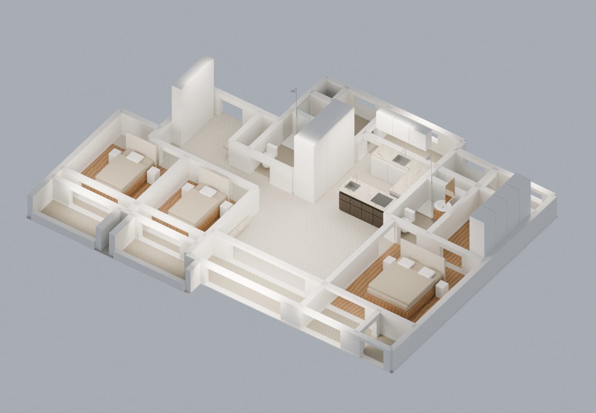
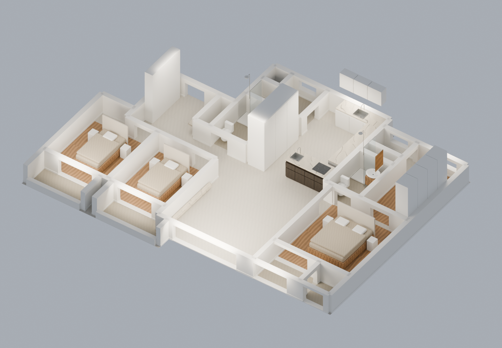

# 3DProperty

사진·평면도와 치수 정보를 활용한 편집 가능한 3D 공간 모델링 프로젝트입니다.

**2026-11-01 공유 기준:** 민규님 홈·집들이 디자인, 재욱님 가구 파이프라인과 최신 좌표 기반 공간 모델을 통합한 코드입니다. 우리 집 기본값은 **112A 확장형**입니다. 112A 기본/확장과 168C 확장은 `archisketch-metric-v1`, 168C 기본은 `archisketch-details-v2`를 사용합니다. 211A 기본/확장은 별도 한 층 보기에서 168C와 연결됩니다. 공용 복도·엘리베이터 배치와 치수는 검토용 가정입니다.

공개 시연: https://cortex-design-preview-20261024.spunky-note-2434.chatgpt.site/ — 소스 푸시와 공개 사이트 배포는 별개입니다. 실행 경로·포함 자산·검증 방법은 [공유 코드 기준](#공유-코드-기준)을 참고하세요.

## 팀 작업과 화면 구성

| 경로 | 현재 역할 | 실행 |
| --- | --- | --- |
| `3DProperty_GUI/` | 재욱의 새 서비스 UI 프로토타입. 3D 렌더러는 아직 연결 전 | 해당 폴더에서 `python3 -m http.server 5186` |
| `src/walkthrough/` | Three.js 공간 탐색·2D/3D 가구 편집 | 루트에서 `npm ci`, `npm run dev`; 5173 기본 화면 |
| `src/mobile/` | 휴대폰·태블릿 터치 조작(왼쪽 아래 방향키·화면 끌어 시선). 같은 5173 뷰어에 연결 | 실기기는 `npm run dev:mobile` |
| `src/concepts/` | 112A 추천 컨셉 배치·색감, 둘러보기 중 테마 전환 (W7-06). 스튜디오에 연결 | 5173의 `?studio=1` → **컨셉 보기** 탭 |
| `src/house-tours/` | 홈(우리 집 · 새로운 집 찾기 · 집들이로 이어지는 첫 페이지)과 집들이: 다른 집의 실제 사진을 보고, 그 테마를 우리 집 평면에 3D로 미리 본 뒤 적용 | 5173 홈 |
| `src/window-view/` | 창밖을 직접 찍은 360° 사진으로 바꿔 보는 기능 (W7-07). 둘러보기에 연결 | 5173의 `?studio=1` → 둘러보기 |
| `apps/web/` | 지도·검색 → 단지 3D → 동·층 → 2D 측정/실내 3D, 가구 JSON 확인 | 해당 폴더에서 `npm ci`, `npm run dev`; 5185 |
| `assets/` | 공유 GLB·Blender 모델·텍스처·치수 근거 | 코드에서 상대 경로로 참조 |
| `tools/blender/` | 모델 수정·내보내기 재현 스크립트 | 각 스크립트의 실행 안내 참고 |

현재 서비스 홈과 지도·공간 뷰어는 연결되어 있으며 `3DProperty_GUI`는 별도 프로토타입입니다. `src/walkthrough`의 렌더링·배치 기능과 `apps/web/src/furniture.js`의 결과 검증을 재사용하는 구성을 권장합니다. 화면마다 모델·배치 상태를 복사하지 말고, 하나의 자산 ID·미터 단위 위치·회전 상태를 공유하도록 연결합니다. 실제 통합과 기존 앱 정리는 별도 PR에서 진행합니다.

7주차 우선순위와 역할은 [MVP 작업 목록](docs/week07-todo.md)에 정리합니다.

협업은 다음 순서를 권장합니다.

1. `main`은 팀원이 실행할 수 있는 통합 버전으로 유지합니다.
2. 작업 시작 시 최신 `origin/main`에서 `feat/<작업명>` 브랜치를 만듭니다. 미커밋 작업이 있는 폴더에서는 먼저 커밋하거나 별도 worktree를 사용합니다.
3. 자기 변경을 커밋하고 브랜치를 push한 뒤 PR로 합칩니다. PR에는 실행 방법, 검증 결과, 화면 캡처, 아직 연결하지 않은 기능을 적습니다.
4. `package.json`, 모델 메타데이터, 공통 JSON 규약처럼 여러 기능이 쓰는 파일은 PR에서 변경 영향을 함께 확인합니다. 공유 `main`에는 force push를 사용하지 않습니다.
5. 치수 근거가 달라지는 모델은 새 버전 폴더로 보관합니다. `node_modules`, 빌드 산출물, Blender 백업, 학습 가중치, 개인 자료는 커밋하지 않습니다.

로컬 Git 작성자는 본인 이름과 GitHub에 연결된 이메일을 사용합니다. 이 작업의 작성자는 `gxonu <kgw8803@gmail.com>`입니다. SSH/GitHub CLI 로그인 계정은 작성자 정보와 별개입니다.

## 웹 개발 시작하기

### Mac에서 H200의 최신 Studio 열기

서버의 최신 지도 서비스와 실내 모델을 보려면 **[open-studio.command](open-studio.command)** 파일 하나를 Mac에 저장하고 더블클릭합니다. 기존 SSH 설정의 `yj1-H200-kinamkim` 연결을 사용하며 요청될 때 비밀번호를 입력합니다. Mac에 Node.js나 모델 파일을 설치할 필요가 없습니다.

최초 한 번만 Mac 터미널에서 실행하면 바탕화면에 파일을 복사하고 실행 권한을 설정합니다.

```bash
scp \
  yj1-H200-kinamkim:/home/nas5/kinamkim/Repos/geonwoo/3DProperty/open-studio.command \
  ~/Desktop/open-studio.command &&
chmod +x ~/Desktop/open-studio.command &&
open ~/Desktop/open-studio.command
```

이후에는 바탕화면의 **open-studio.command**를 더블클릭합니다. SSH 연결과 지도·뷰어 서버 시작/재사용을 처리한 뒤 **지도에서 위치 선택** 화면을 엽니다. 아크로리버파크를 고르면 단지 3D → 동·층 → 2D 평면·측정 / 실내 3D로 이어집니다. 다른 위치는 준비 중 목업입니다. Mac 잠자기 등으로 연결이 끊겼다면 다시 더블클릭합니다. 실행 완료 후 터미널 창은 닫아도 됩니다. 이전 파일을 이미 받았다면 위 명령을 한 번 다시 실행해 갱신합니다.

기본 로컬 포트는 뷰어 **35173**, 지도 **35185**이며, 각각 사용 중이면 비어 있는 포트를 자동으로 선택하고 기억합니다. 구버전의 뷰어 포트·SSH 연결은 유지하고 지도 포워딩만 추가합니다. 실제 뷰어 주소를 `viewerUrl`, 지도 복귀 주소를 `serviceUrl`로 전달하므로 임의 로컬 포트도 연결됩니다. 포트가 바뀌면 이전 저장 배치는 이전 주소에 남습니다. 비밀번호는 SSH에서 직접 입력하며 실행 파일에 저장하지 않습니다.

종료가 필요하면 Mac에서 `bash ~/Desktop/open-studio.command --stop`을 실행합니다. 이 파일의 지도·뷰어 SSH 연결만 닫으며, 서버·Blender MCP·다른 사용자의 포트는 유지합니다. 서버 도우미는 `tools/start-remote-studio.sh`, 로그는 `runtime/dev/remote-studio.log`와 `remote-service.log`입니다. 서버가 이미 실행 중이면 재시작하지 않습니다. 새로 시작할 때는 가구 추론 API가 비활성인 웹 전용 모드입니다.

### Mac의 로컬 소스로 개발하기

기본 시작 화면은 **http://localhost:5185 (`apps/web`)의 지도**다. 루트와 `apps/web`에서 최초 1회 `npm ci` 후, 루트에서 **`bash start.sh`** 하나로 웹과 3D 뷰어를 실행한다. GPU 서버 API가 준비돼 있으면 SSH 터널도 켜서 이미지 측정을 연결하고, 서버가 없으면 이미지 미리보기·JSON 확인·3D 기능만 사용한다. 서버 API 실행과 SSH 설정은 [가구 측정 실행 안내](services/furniture_pipeline/README.md)를 따른다. 5173은 서비스 시작 화면이 아니라 3D 공간 뷰어다. 기존처럼 두 폴더의 `npm run dev`와 `npm run furniture:tunnel`을 수동 실행해도 된다. 수동 개발 실행의 API 설정과 별개로 `open-studio.command`는 새 서버를 웹 전용 모드로 시작하며 기존 서버의 설정은 바꾸지 않는다. 이후 API를 연결했다면 두 Vite 서버를 재시작한다. 명시한 `VITE_FURNITURE_MEASUREMENT_ENABLED=0/1`은 자동 감지보다 우선한다.

### 단지 → 세대 → 방 선택 및 꾸미기

`http://localhost:5185/`에서 지도 → 아크로리버파크 → 동·층 → 체험 평면으로 이동합니다. 5173의 기본 주소도 지도로 안내합니다. `?studio=1`, `?studio=0`, `?variant=...`처럼 명시한 기존 링크는 뷰어 직접 진입을 유지하며 상단 **지도에서 위치 찾기**로 서비스에 돌아옵니다. 아크로 외관은 OSM 윤곽·높이에 기반한 시각화이고 실제 층·호·타입 매핑은 미확인입니다. 네 실내 모델은 별도 체험 평면입니다. 임의 SSH 포트는 새 런처가 자동 연결하며 수동 연결은 [진입 주소 계약](docs/web-integration.md)을 참고하세요.

꾸미기 화면 왼쪽은 미터 좌표의 2D 평면, 오른쪽은 같은 상태를 사용하는 실시간 3D입니다. 소파·스툴·침대를 드래그/수치 이동하고 추가·회전·삭제할 수 있습니다. 벽/고정 집기/다른 가구와의 평면 겹침을 검사합니다. 조작 종료 후 보행 충돌 메시를 갱신합니다. 배치는 기본형/확장형별로 현재 브라우저에 저장·불러오기하며, 서버 저장이나 Blender로 편집 결과 역전송은 아직 없습니다. 1인칭 이동은 PC 키보드·마우스와 휴대폰·태블릿 터치를 지원합니다. 현재 네 평면에는 고정 주방·욕실 설비가 포함되며, 배치한 소파·테이블 및 112A 침대·서재 가구를 편집할 수 있습니다.

아래 `dimensioned-v3` 관련 문단은 이전 112A 모델의 이력입니다. 현재 웹 모델은 위의 치수 기반 갱신 문서를 따릅니다. 이전 모델은 `dimensioned-v3`로 보존합니다. 천장고 2.6m는 [ACRO 공식 안내](https://www.acro.co.kr/Posm_main.action?commonMap.CD_BIZ_LND=010366) 기준입니다. 문 개구부 높이 2.1m는 이번 모델의 설계 가정이며 실제 단지 문 규격으로 검증하지 않았습니다. [한샘 도어 카탈로그](https://image2.hanssem.com/event/doc/catalog/Hanssem_Door_2601.pdf)는 제품별로 제작 높이 범위를 안내하며 모든 문에 단일 높이가 적용되는 것은 아닙니다.

안방 매트리스는 킹 1670×2075mm([ACE K 규격](https://www.acebed.com/product/bed/mattress/view.do?detailsKey=24))를 유지하고 참고 배치도처럼 머리판이 서쪽을 향하도록 회전했습니다. 작은 방 1은 빈 방, 작은 방 2는 책상·의자로 바꿨습니다. 책상 120×60×74cm, 의자 외곽 54×55×85cm는 선택한 설계값이며 실측값이 아닙니다. 작은 방 방문 경첩 방향과 전면 발코니 창호를 참고 이미지에 맞춰 수정했고 발코니도 장소 목록에서 선택할 수 있습니다.

기존 17개 도면 치수 구간과 확장부 추정 범위를 유지하며 기본형 바닥 18개·확장형 바닥 14개의 경계가 v2와 동일함을 검사합니다. 가운데 작은 방은 기본형 2.458×2.593m, 확장형 약 2.458×3.08345m입니다. 도면 사이 구간은 보간, 확장은 추정 시나리오이므로 전체 건물 실측 일치를 의미하지 않습니다. 생성 명령은 `uv run --offline --python 3.11 --with bpy==4.5.3 python tools/blender/update_reference_revision.py`이며 결과·검사 기록·방 치수 CSV·모델에서 추출한 치수 SVG는 `assets/models/acro-river-park/112a/dimensioned-v3/`에 있습니다. 확장형 SVG는 독립적인 원본 치수 도면이 아닙니다. v1·v2와 `week-06-presentation` 태그는 보존합니다.

1인칭 기본값은 눈높이 1.60m, 충돌 몸체 지름 44cm, 머리 상단 1.72m, 가로 시야각 85°이며 수평으로 바라봅니다. **사람 크기 · 시점 · 화질**에서 눈높이·몸체 폭·가로 시야각을 바꿀 수 있습니다. **화면 크기 보정**은 실제 모니터 가로 길이와 눈–화면 거리로 투영각을 계산하며 기본 입력 32cm/60cm는 예시입니다. 화면 물리 크기와 브라우저 배율을 맞춰야 하며 양안시·실제 공간의 깊이 감각까지 재현하는 기능은 아닙니다. 기존 배치 저장값은 v2 키에 남겨두고 새 기본 배치는 v3 키에 저장합니다.

Node.js 20.19 이상이 필요합니다. Blender나 MCP 없이 포함된 GLB로 실행할 수 있습니다.

```bash
git clone https://github.com/JaeWook-S/3DProperty.git
cd 3DProperty
npm ci
npm run dev
```

별도 터미널에서 서비스 화면도 실행합니다.

```bash
cd 3DProperty/apps/web
npm ci
npm run dev
```

- 서비스 시작 화면: http://localhost:5185 — 공간 선택·기존 가구 JSON 확인·이미지 등록과 측정. 웹 틀은 `apps/web/src/main.js`, `style.css`에서 이어 개발합니다.
- 공간 Studio: http://localhost:5173 — 단지 탐색·꾸미기·가구 등록·둘러보기. 코드는 `src/walkthrough/`에 있습니다.
- 단독 둘러보기: http://localhost:5173/?studio=0&variant=expanded — 최신 112A 확장형 구조를 엽니다. 소파·테이블·4인 식탁·안방 침대·책상 배치를 포함합니다.

두 화면은 직접 링크로 연결됩니다. 이미지 업로드·치수 측정 뒤 고정 Blender 테스트 테이블을 GLB로 생성하여 웹 미리보기와 Studio 배치·이동·회전·저장/복원을 지원합니다. GPT API는 호출하지 않으며 사진 속 형태를 재현한 모델은 아닙니다. 서버 Blender 설치와 실행은 [실행 안내](services/furniture_pipeline/README.md), 두 웹 화면의 통합 기록은 [웹 연동 문서](docs/web-integration.md)를 참고하세요.

각 앱 폴더에서 `npm test`와 `npm run build`로 확인합니다. 브라우저 검사는 `npx playwright install chromium` 후 `npm run test:browser`로 실행합니다. 서비스 앱 브라우저 검사에는 5173 뷰어도 필요합니다. 비공개 S2 자료가 필요한 검사는 해당 환경 변수가 없으면 skip됩니다.

## 포함된 가구

둘러보기에서 가구를 바라보고 **P**를 누르면 상품 카드가 열립니다. 정보 확인 중에는 이동·시점 회전이 멈추고 커서를 사용할 수 있으며, 다시 **P**를 누르면 이동을 재개합니다. 오른쪽 3D 평면/꾸미기 화면에서는 가구에 마우스를 올려 **+** 버튼으로 작은 상품 카드를 엽니다. 왼쪽 2D 평면의 상품 동작은 추가하지 않았습니다. 두 카드의 상품 정보는 `public/furniture-products.yaml`에서 수정합니다. [사용·수정 가이드](docs/furniture-info.md)를 참고하세요.

`assets/furniture/catalog-sofa2790-stool980-v1/`에 개별 GLB, 거실 배치 GLB와 치수 manifest가 있습니다. 소파는 2790×1170×730mm, 스툴은 980×700×400mm입니다. 상품 이미지 표기 치수를 사용했으며 독립 실측은 아닙니다. 미표기 세부 형태는 근사했고 소파 높이 980mm 조절 상태는 구현하지 않았습니다.

## 2026-10-26 통합 기준

원격 `a735b68..1f70f46`의 7개 커밋을 통합했습니다. 웹 화면·집들이·추천 컨셉은 민규님 버전, 가구 생성·재질 파이프라인은 재욱님 버전, 집 구조·치수·문·동선과 112A/168C/211A 모델은 기존 최신 작업을 기준으로 유지합니다. 최신 기능을 연결하면서 구형 평면 별칭과 방 ID를 현재 좌표 모델로 대응하고, 세대별 배치 저장을 보존합니다.

SuperMat 및 GPT 코드 생성은 서버 기능입니다. 공개 웹은 기존과 같이 이미지 미리보기·준비된 모델 체험이며 실제 AI 호출을 실행하지 않습니다. 서버에서도 `PIPELINE_SUPERMAT_ENABLED=true`와 GPT provider 설정을 각각 명시해야 합니다. 이번 병합 검증은 CPU·모의 API 호출로 수행하며 H200 연산이나 유료 호출 성공을 뜻하지 않습니다.

## 웹 공간 체험

### 6주차 이후 스튜디오 개선

`week-06-presentation` 태그는 발표 기준 `72b8007`을 보존합니다. 최신 개선과 미니맵은 `main`을 기준으로 개발하며 `/?studio=1`로 확인합니다. 역할과 다음 순서는 [7주차 TODO](docs/week07-todo.md)에 정리했습니다.

- 첫 화면: 민규님 홈 디자인의 대표 집들이·우리 집·테마 추천을 사용합니다. 새로운 집 찾기에서 지도 검색 → 3D 단지 → 동·층·호수 → 2D/실내 3D로 이어집니다.
- 동·층·호수: 100–114동과 제공된 세대 타입 자료를 연결합니다. 112A/168C 지원 호수는 기본형·확장형을 직접 선택하며 실제 확장 상태는 미확인으로 유지합니다. 위층 숨기기와 선택층 호수 미리보기를 지원합니다.
- 주변 탐색: OSM 기반 15개 동과 주변 강·녹지·도로·건물을 표시합니다. 선택 동·단지 전체·강변·도로 시점을 바꿀 수 있습니다. 외관·창호·조경과 일부 주변 건물 높이는 시각화 가정입니다.
- 세대: 2D/3D 장소 선택 또는 선택 메뉴에서 거실·방·주방·욕실·현관을 골라 편집/둘러보기로 전환합니다.
- 가구: 기본적으로 겹침을 허용하고 실시간 경고를 표시합니다. `겹침 허용`을 끄면 이후 이동에서 겹침·방 경계 이탈·문 개방 간섭을 제한합니다. 기존 배치를 자동 변경하지 않습니다. 경고 배치도 저장·복원이 가능하며 방 밖으로 옮겨도 선택 목록에 남습니다.
- 편집 도구: 좌측은 가구 선택·추가·치수·좌표 입력, 2D 하단은 회전·삭제, 3D 하단은 방 전체 보기·둘러보기입니다. 공통 하단에 저장·복원·초기화, 겹침 허용 토글과 실시간 경고를 배치했습니다. 하단 도구 높이를 제외한 영역에 도면과 3D를 맞춥니다.
- 경고: 가구 중첩, 방 경계, 고정 집기, 가정한 문 개방 범위, 가구 사이 60cm 미만 여유. 가구 외곽의 2D 계산이며 접근성 기준이나 실제 통행 가능 여부를 인증하지 않습니다. 1인칭 신체 충돌은 유지합니다.
- 미니맵: 둘러보기에서 현재 위치·시선 방향·방을 표시하며 기본형/확장형과 편집한 가구를 반영합니다. PC는 `M`, 모바일은 버튼으로 접거나 펼칩니다. 지도 위쪽은 도면 상단입니다.
- 집들이·우리 집: 참고 집들이를 필터로 찾아보고, 테마를 현재 평면에 맞춰 미리 본 뒤 적용하거나 되돌립니다. 최근 적용 테마를 다시 사용할 수 있습니다. 집들이의 평수·가족 구성·인기 수치는 예시 데이터이며 사용자 실거주 기록이 아닙니다. [집들이 안내](docs/house-tours.md)를 참고하세요.
- 컨셉 보기: 가족 구성과 분위기를 선택하면 112A용 8가지 컨셉을 추천합니다. 현재 아키스케치 모델의 방 경계·고정 집기·문 개방 범위로 배치를 검사하고, 맞지 않는 가구는 작은 규격으로 대체하거나 제외합니다. 168C 자동 컨셉 배치는 아직 지원하지 않습니다.
- 걸으면서 테마 바꾸기: 테마·색감을 바꾸고 목록을 열 수 있습니다. 기존 미터 좌표와 문·충돌 기준을 유지합니다. [추천 컨셉 배치](docs/recommended-concepts.md)를 참고하세요.
- 창밖 풍경: 참고 사진과 사용자 360° 파노라마를 지원합니다. 특정 동·층의 실제 조망을 보증하지 않으며, 사용자 업로드와 낮·밤 선택을 유지합니다. [창밖 풍경](docs/window-view.md)을 참고하세요.
- 공용층: 별도 211A·168C 기본형/확장형 검토 화면에서 현관·복도·엘리베이터를 연결했습니다. 공용부 크기와 세대 간 위치는 가정이며 실제 100동 전체 층 배치가 아닙니다.


동 윤곽·높이는 OSM 자료, 세대 타입은 사용자가 제공한 동호수 자료를 사용합니다. 실제 공용부 배치·현관 방향·확장 상태는 미확인입니다. 전체 단지를 실측 복원한 결과가 아닙니다. [단지 자료 출처와 가정 범위](assets/location/acro-river-park/provenance.json)를 참고하세요. 네이버 부동산 매물·단지 데이터 API는 공식 공개 API 목록에서 확인되지 않았으며 지도 API와 구분합니다. 현재는 API 키가 필요 없는 지도 검색 링크를 사용합니다.

기본형·확장형을 선택해 실제 미터 스케일로 불러와 1인칭으로 걸어볼 수 있습니다. 눈높이·시야각 조절, 벽·가구 충돌, 가까운 문 여닫기(E/클릭), 접촉 그림자를 적용했습니다. 낮·해질녘·밤 조명과 원본·오크·석재 마감, 울트라 화질을 선택할 수 있습니다.

2026-10-21 최적화부터 기본 화질은 **균형 · 부드러운 조작**입니다. 고화질·울트라는 화질 메뉴에서 선택할 수 있습니다. 정적인 벽·집기를 재질별로 묶어 그리고, 카메라만 회전할 때에는 그림자를 다시 계산하지 않습니다. 가구 이동·문 개방·조명 변경 시 그림자는 갱신합니다. 2D 드래그 처리는 화면 갱신 주기에 맞추며 숨긴 탭은 렌더링을 멈춥니다. 원본 BLEND·GLB·치수 JSON과 편집·충돌용 좌표는 유지합니다.

112A 확장형 전체 보기의 동일 고화질 조건에서 프레임당 렌더링 호출 수는 1,397회에서 369회로 줄었습니다(약 74%). Linux Chromium/SwiftShader 측정이며 실제 Mac·iPhone의 FPS나 SSH 전송 속도를 의미하지 않습니다. 단위 검사 83개, 문·마감·컨셉·모바일 브라우저 검사 7개와 빌드를 통과했습니다. 로컬 비교 기록과 원본 대조 해시는 `runtime/performance/2026-10-21/verification.json`에 있습니다.


```bash
npm ci
npm run dev
```

http://localhost:5185 에서 단지 → 동·층 → 체험 평면 → 실내 3D의 장소를 골라 둘러봅니다. 선택 층과 체험 평면이 실제 세대 배정을 뜻하지는 않습니다. 기존 단독 뷰어는 http://localhost:5173/?studio=0 에서 **공간에 들어가기**를 누릅니다. WASD 이동·마우스 시선·Esc 해제는 동일합니다. 서버 접속 방법, 설정 근거와 검증 범위는 [공간 체험 안내](docs/walkthrough.md)를 참고하세요.

휴대폰·태블릿은 같은 Wi-Fi에서 `npm run dev:mobile`을 실행하고 터미널의 Network 주소를 엽니다. **공간에 들어가기**를 터치하면 왼쪽 아래 방향키로 걷고, 오른손으로 화면을 끌어 둘러보며, 문 앞에서는 오른쪽 아래 버튼으로 여닫습니다. 자세한 조작과 검증 범위는 [휴대폰·태블릿 공간 체험](docs/mobile-walkthrough.md)을 참고하세요.

## 현재 공유 모델

최신 편집용 BLEND와 실행용 GLB·metadata의 경로는 [공유 코드 기준](#공유-코드-기준)에 정리했습니다. 아래 `dimensioned-v1/v2/v3` 자료는 이전 도면 보정과 미리보기 이력이며 현재 활성 모델이 아닙니다.

**[아크로리버파크 112A · 기본형/확장형 · dimensioned-v1](assets/models/acro-river-park/112a/dimensioned-v1/README.md)**

치수 기반 Blender 파일 두 개와 조감도, 치수 도면, CSV, 검증 기록을 공유합니다. 원하는 `.blend` 파일을 내려받아 Blender에서 열면 됩니다. 텍스처는 파일에 포함되어 있습니다.

| 기본형 | 확장형 |
| --- | --- |
|  |  |

## 폴더 구조

```text
assets/
  furniture/             # 규격 기반 가구와 거실 배치 GLB
  materials/             # 웹용 마감 텍스처
  models/
    acro-river-park/
      112a/
        dimensioned-v1/
          README.md
          manifest.json
          calibration.json
          comparison.json
          basic/       # 기본형 모델·미리보기·치수·검증
          expanded/    # 확장형 모델·미리보기·치수·검증
src/
  walkthrough/          # 미터 기반 1인칭 탐색·가구 편집
  mobile/               # 휴대폰·태블릿 터치 조작 (walkthrough 뷰어에 연결)
  concepts/             # 추천 컨셉 배치·색감, 코드로 만든 가구, 둘러보기 테마 막대
  house-tours/          # 홈, 헤더, 집들이 목록·상세·우리 집 적용, 디자인 토큰
  window-view/          # 창밖 360° 사진 바꾸기 (둘러보기에 연결)
apps/
  web/                  # 공간 선택·가구 결과 확인 서비스 화면
tests/                  # 이동·충돌·브라우저 검증
docs/
  repository-structure.md
  walkthrough.md        # 실행·조작·치수 기준
  recommended-concepts.md  # 추천 컨셉 배치 기준과 검증
  house-tours.md        # 홈, 집들이, 우리 집 맞춤 방식, 이미지 렌더링
  design.md             # 디자인 기준 (토큰, 글자, 쓰지 않는 것)
  window-view.md        # 창밖 사진과 실제 조망 단계
```

자세한 추가·수정 기준은 [레포 구조 안내](docs/repository-structure.md)를 참고하세요. 실제 건물 실측 정확도와 미표기 높이 등은 각 모델 README의 범위를 확인해야 합니다.


## 공유 코드 기준

2026-11-01 기준으로 서비스 소스, 모델 생성기, 테스트, 실제 웹에서 읽는 자산과 최신 편집용 BLEND를 함께 관리합니다. 기존 실험용 대형 모델 중 실행·회귀 검사에 필요 없는 이전 버전, `startup/` 사업 자료·Sites 전용 저장소·배포 압축본, `runtime/` 로그, `.env`·키·학습 가중치는 이번 소스 공유에 포함하지 않습니다. 해당 로컬 파일을 삭제하거나 공개 사이트를 재배포하지 않습니다.

| 용도 | 자산 경로 |
| --- | --- |
| 112A 기본·확장 | `assets/models/acro-river-park/112a/archisketch-metric-v1/{basic,expanded}/` |
| 168C 기본 | `assets/models/acro-river-park/168c/archisketch-details-v2/basic/` |
| 168C 확장 | `assets/models/acro-river-park/168c/archisketch-metric-v1/expanded/` |
| 211A 기본·확장 | `assets/models/acro-river-park/211a/archisketch-structure-v1/{basic,expanded}/` |
| CC0 가구 4종 | `assets/furniture/cc0/`의 모델·미리보기·출처 manifest |
| 서비스 2D·동호수 | `apps/web/public/floorplans/`, `src/property/`의 경량 JSON |

위 폴더의 BLEND·GLB·model-info가 편집·실행 기준입니다. 이전 구조 검토 페이지와 회귀 검사가 직접 참조하는 일부 과거 GLB/metadata도 유지합니다. 원본 도면·VR 사진·전체 데이터셋과 모델 재생성에 필요한 일부 외부 입력은 별도 관리하며, 웹 실행에는 필요하지 않습니다.

두 앱에서 각각 `npm ci`를 실행한 뒤 루트의 `bash start.sh`로 실행합니다. GPU 서버가 없어도 웹 전용 모드를 사용할 수 있습니다. 우리 집·집들이는 `http://localhost:5173/`, 지도는 `http://localhost:5185/`, 한 층 보기는 `http://localhost:5173/paired-floor-review.html`입니다. 새 GPU 추론이나 유료 API는 별도 설정·승인 없이 실행하지 않습니다.

```bash
npm test
npm --prefix apps/web test
VITE_FURNITURE_MEASUREMENT_ENABLED=0 npm run build
VITE_FURNITURE_MEASUREMENT_ENABLED=0 npm --prefix apps/web run build
node tools/build-paired-floor-review.mjs
```

동호수 원본 CSV 대조 검사 2개는 별도 원본이 있을 때만 실행합니다. 다른 환경에서는 `CORTEX_UNIT_SOURCE_CSV=/path/to/acroriverpark_units.csv npm test`로 지정할 수 있습니다. 원본이 없으면 이 두 검사만 skip되고 공개 카탈로그의 타입·호수·잘못된 입력·선택 상태 검사는 계속 실행됩니다. 브라우저 검사 중 과거 실험 모델·비공개 입력을 요구하는 검사는 각 검사 파일의 조건과 과거 기록을 확인하세요.

한 층 보기의 가구 검토는 문 단면·승강기 내부 수용·현관 앞까지의 후보 이동/회전 경로를 나누어 계산합니다. 열린 문짝·문틀을 포함하며, 공용부는 가정 배치입니다. 세대 안 운반·기울이기·분해·운반자·장비·무게와 모든 가능한 경로는 검사하지 않습니다.
